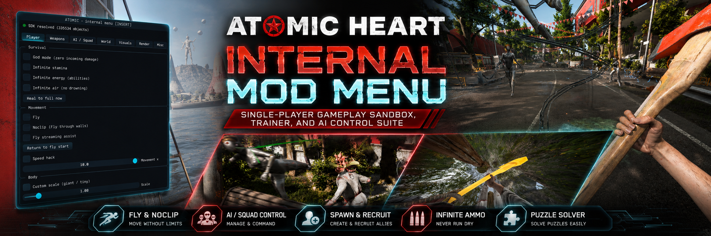

<p align="center">
  
</p>

<p align="center"><sub><i>yes, this banner is AI-generated. no, we are not fans of AI art either (we know, the irony). if you are an actual artist who wants to make something better, please, save us: open an issue or hop in the Discord.</i></sub></p>

<p align="center">
  <a href="https://discord.gg/pDC3dnxsfZ"></a>
  <a href="LICENSE"></a>
  
</p>

# Atomic Heart - Internal Mod Menu

An **internal** (injected DLL) trainer / mod menu for **Atomic Heart** (single-player,
Unreal Engine 4.26/4.27). It hooks the game's **DirectX 12** swapchain to draw a
[Dear ImGui](https://github.com/ocornut/imgui) overlay and uses a small UE4 runtime
SDK to read/write game objects and call any `UFunction` via `ProcessEvent` - the
mechanism that gives you "do anything" control.

> Single-player only. Atomic Heart has no multiplayer; this affects no other players.

---

## Project status and honest disclaimer

Read this before judging the repo.

- **This is a beta.** It is a work in progress, not a finished or polished release.
- **The current layout is rough.** The menu organization and the code structure are
  honestly kind of a mess right now and will keep changing. Do not expect clean
  architecture yet.
- **Written by an amateur developer.** Expect large bugs, half-finished features,
  dead code, and leftover artifacts from AI coding assistants. Use at your own risk
  and read the code before you trust it.
- **Single-player only.** Atomic Heart has no multiplayer, so nothing here affects
  other players. This is an unofficial, non-commercial fan tool.
- **The docs are AI assisted.** This README and `PROJECT_AND_SDK.md` were written
  with AI help because of the author's restrictive English. The AI turns rough notes
  into readable docs, so wording may sometimes describe intent more cleanly than the
  code actually delivers. Trust the code over the prose where they disagree.

### Credits and dependencies

- **Dear ImGui** by Omar Cornut (ocornut) for the overlay UI: https://github.com/ocornut/imgui
- **MinHook** by Tsuda Kageyu for function hooking: https://github.com/TsudaKageyu/minhook
- **Dumper-7** by Encryqed, used to dump the game SDK and offsets: https://github.com/Encryqed/Dumper-7
- **Atomic Heart** by Mundfish, the game itself. This project is not affiliated with,
  endorsed by, or supported by Mundfish.

The vendored Dear ImGui and MinHook sources keep their own upstream licenses.

### License

This project is licensed under the **GNU General Public License v3.0 or later
(GPL-3.0-or-later)**, with additional attribution terms under GPLv3 Section 7.
See [`LICENSE`](LICENSE) for the full license text and [`NOTICE`](NOTICE) for the
additional terms and the third-party credits.

In short:
- It stays open source. Use, study, modify, and share it freely.
- **Copyleft / share-alike**: any fork, modification, or redistribution must stay
  licensed under the same GPL-3.0-or-later terms and remain open source. You may
  not close it off or relicense it under more restrictive terms.
- **Attribution is required**: you must keep credit to the original author
  (Skorchekd) and to Dumper-7 (Encryqed), MinHook (Tsuda Kageyu), and Dear ImGui
  (ocornut). The vendored libraries stay under their own permissive licenses,
  which are GPL-compatible.

> Note: the dumped game SDK (`dumped-sdk/`) is **not** included in this repo. It is
> large, build-specific, and only needed as reference when adding new features. The
> menu builds and runs without it. Regenerate it by running Dumper-7 against your own
> copy of the game (see "Resolving the offsets" below).

---

## Goals and roadmap

The long-term goal is for Atomic Heart Menu to become effectively
**CyberEngineTweaks but for Atomic Heart**: a deep, do-anything toolkit built on
the game's own Unreal Engine 4 reflection and `ProcessEvent`, rather than just a
fixed list of cheat toggles.

Planned and in-progress directions:
- **Object and actor spawning**: spawn, configure, and control game objects,
  items, and entities at will.
- **In-game level design tools**: place, move, and edit world geometry and actors
  to build or reshape scenes live.
- A steadily growing, extensible feature set as SDK coverage expands.

This is a beta and a solo, amateur project, so the roadmap is aspirational and
timelines are loose. Contributions are welcome, see
[`CONTRIBUTING.md`](CONTRIBUTING.md).

---

## Target

| | |
|---|---|
| Process | `AtomicHeart-Win64-Shipping.exe` (the launcher `AtomicHeart.exe` is separate) |
| Architecture | x64, base `0x140000000` |
| Render backend | **DirectX 12** (`D3D12Core.dll` + `d3d11on12.dll` + DLSS) |
| Build toolchain | Visual Studio 2022 (Community or Build Tools) with the C++ workload |

That's why the render hook targets DX12, not DX11.

---

## Architecture

```
src/
  dllmain.cpp          Entry: spawns worker thread, installs hooks, eject on END key
  core/
    globals.h          Shared atomics (running / menuOpen / sdkReady) + module info
    log.{h,cpp}        File + console logging  -> AtomicHeartMenu.log next to the exe
  hooks/
    dx12_hook.{h,cpp}  DX12 Present / ResizeBuffers / ExecuteCommandLists hooks (MinHook)
                       + ImGui DX12 backend, RTV/SRV heaps, command-queue capture
    wndproc_hook.{h,cpp}  Window subclass: feeds input to ImGui, INSERT toggles menu
  menu/
    menu.{h,cpp}       The ImGui window (themed: Player / Weapons / AI·Squad / World / Visuals / Render / Misc / Achievements / Debug tabs)
  features/
    features.{h,cpp}   Per-frame cheat application (godmode, fly, speed, teleport...)
  sdk/
    ue4.{h,cpp}        Minimal UE4 SDK: FName/UObject/GObjects/GWorld + ProcessEvent
    scanner.{h,cpp}    AOB / signature scanner for resolving engine globals
    offsets.h          *** ALL build-specific offsets & signatures live here ***
tools/
    injector.cpp       Minimal LoadLibrary injector -> bin\injector.exe
    find_globals.py    Recover GObjects/GNames/GWorld from the exe after a patch
deps/
    imgui/  minhook/   Vendored dependencies (already cloned)
```

**Controls:** `INSERT` opens/closes the menu. `END` ejects the DLL cleanly.
With **Fly** or **Noclip** enabled and the menu closed, movement is Minecraft-style
free-fly: `W/A/S/D` move relative to camera yaw, `SPACE` goes up, and `SHIFT` goes
down. **Noclip** additionally turns the player's collision off so you pass straight
through walls/floors (Fly keeps collision on). The `Movement x` slider controls
walk, fly, and noclip speed. Fly/Noclip also capture a return point when enabled
and, with **Fly streaming assist** on, periodically invalidate Atomic Heart's
streaming state so moved-to areas can load instead of leaving the pawn in an
unloaded void.

Maintenance rule: after each code or behavior change, update this markdown
and `PROJECT_AND_SDK.md` in the same pass so feature notes do not go stale.

---

## Build

Easiest - double-click **`build.bat`**. It uses CMake from `PATH` if there is one,
otherwise the copy bundled with your Visual Studio 2022 install (Build Tools ships
CMake but puts nothing on `PATH`). Equivalent by hand:

```bat
cmake -S . -B build -G "Visual Studio 17 2022" -A x64
cmake --build build --config Release
```

Output:
- `bin\AtomicHeartMenu.dll` - the menu
- `bin\injector.exe` - the injector

The DLL uses the **static CRT** (`/MT`), so the target needs no VC++ redistributable.

---

## Run

1. Launch Atomic Heart, get into the game world.
2. Inject (run as admin):
   ```bat
   bin\injector.exe AtomicHeart-Win64-Shipping.exe bin\AtomicHeartMenu.dll
   ```
   (or use any injector - Xenos, Process Hacker → Inject DLL, etc.)
3. Press **INSERT** in-game. You should see the menu and, at the top, an
   **SDK: resolved** banner with a live object count.

If it says **SDK: NOT resolved**, the signatures in `offsets.h` didn't match this
patch - see below. The menu still draws (proving the render hook works); only the
game-interaction features are gated on SDK resolution.

A live console opens on injection for real-time copy/paste logging. The same lines
are also written to `AtomicHeartMenu.log` next to the game exe - check it first
when something doesn't work.

Performance note: hook enabling is batched through MinHook's queue and logged with
timings. SDK function/object resolving runs from the worker thread, not the DX12
`Present` hook. `FindObject()` first uses dumped `GObjects` index hints for known
functions, weapons, ammo, and streaming helper objects, then only falls back to a
scan if the build no longer matches those hints. Weapon/ammo assets are not bulk
prewarmed at injection. Per-frame `ProcessEvent` calls are kept feature-gated:
actor location is read only for coordinates/fly, infinite-ammo polling is
throttled, and overlay fence waits skip drawing instead of blocking the game.
Feature commands use a no-scan lookup path; if a dumped asset index is unstable,
a background object-name index resolves it without freezing the render thread.

---

## What works out of the box vs. what needs *your* offsets

This is the important part. **The render/input/menu layer is complete and game-agnostic.**
The game-interaction layer depends on values that are unique to your exact game build.

### Current wired features
These are wired for the Dumper-7 SDK currently in `dumped-sdk/`:
- **God mode** - freezes incoming damage multiplier at `0`, tops health, clears `bIsDead`;
  disabling restores the captured incoming-damage and health attribute values.
  If an old save/session already has the cheat value persisted, disabled state
  normalizes the damage multiplier back to `1.0`
- **One-hit kill** - boosts outgoing damage multiplier; disabling restores the
  captured multiplier. If an old save/session already has the cheat value
  persisted, disabled state normalizes it back to `1.0`
- **Infinite stamina / energy / air** - tops GAS attribute values every frame;
  disabling restores the captured resource attribute values
- **Fly** - `MOVE_Flying` plus manual camera-relative free-fly movement and
  Atomic Heart streaming invalidation/update assist; disabling restores the
  captured movement mode and fly speed
- **Noclip** - same free-fly movement as Fly plus
  `Function /Script/Engine.Actor.SetActorEnableCollision(false)` so the player
  passes through level geometry; disabling re-enables collision and restores the
  captured movement mode and fly speed
- **Speed** - writes `MaxWalkSpeed` / `MaxFlySpeed`; disabling restores captured walk speed
- **Show coordinates** - `Function /Script/Engine.Actor.K2_GetActorLocation`
- **Save / Teleport to position** - `Function /Script/Engine.Actor.K2_SetActorLocation`
- **Infinite ammo** - fills known ammo data assets into the player inventory,
  raises the inventory infinite-ammo/capacity fields, and tops the current
  weapon/EBBarrel loaded ammo; disabling restores captured inventory ammo-gate
  fields, disables the inventory overweight bypass, and restores current-weapon/
  EBBarrel fields. **Refill ammo now** forces the same refill path once and does
  not own toggle restore state
- **Misc → Instant puzzle resolve** - toggles Atomic Heart's own
  `DebugSubsystem.SetInstantPuzzleResolve` path AND continuously auto-completes
  the two interactive puzzle families the debug path does not cover:
  `BPC_MiniGameBase_C` minigames (dials/grids, electric lockpick - via
  `MiniGame_SetComplete`/`SetGameComplete`) and `BP_LockComponent_C` door locks
  (the CodeLock button grid, ColorsLockPick, CoinLock, UniversalLock - via
  `Unlock()`). Discovery (the GObjects sweep) runs on the **worker thread**, never
  the Present hook, so it does not freeze the game
- **Misc → Solve / pass current puzzle** - pulses instant puzzle resolve, calls
  `DebugSubsystem.InstantLockUnlock` plus `DebugSubsystem.WinQTE`, and queues a
  one-shot minigame/lock completion pass (it pops within a frame or two; on a
  miss it also logs the live puzzle-class candidates for diagnosis)
- **Misc → Unlock current lock / Win active QTE** - one-shot buttons for lock
  bypasses and active QTE passes
- **Give weapon** - dropdown grants one weapon via `AAHPlayerCharacter::InstantTakeWeapon`
  and equips it; **Give all** paces one listed weapon per tick instead of granting
  all in one blocking click. Both run **on the game-thread pump**, not from the
  Present hook: a grant is inventory mutation plus a weapon actor spawn/attach, and
  dispatching that off the game thread faulted inside the engine and then hung the
  game (`Skorchekd/AtomicHeartMenu#6`). The buttons
  therefore report only that the request was accepted; the result is logged a frame
  or so later. The receiver is checked with `IsA(AHPlayerCharacter)` and the asset
  against the type the UFunction's own parameter declares, so a non-player pawn or a
  wrong-class asset is refused instead of dispatched. The **equip is deferred and
  retried** rather than issued in the same breath as the grant: the take returns
  before the weapon actor exists, and equipping an asset with no instance yet does
  nothing, which left the weapon in the wheel but not in your hands. **Weapons with
  no content in your install are skipped before the grant**: those still take but
  arrive as named empty storage slots with no model, which crash on equip and wedge
  weapon switching if selected. The check reads the live asset rather than a
  hardcoded list, so a patch or a DLC purchase moves the set on its own. The
  Kalash rifle is listed as **Kalash Rifle / AK-47**
  (`DA_Item_AK47`)
- **AI / Squad tab** - full control over the AI (the headline feature):
  - **AI control roster** - a live list of nearby AI. **Tick** units to select them
    (selected + squad units get an in-world **glow box + arrow overhead**), then
    **Recruit sel.** / **Recruit all nearby** to add them to your **squad**, or
    **Attack >** / **Kill sel.** to dispatch them. Recruiting is now **explicit** - the
    old "bodyguard mode / follow me" auto-recruit toggles are gone, replaced by this
    managed roster.
  - **Squad** members **walk-follow** you and fight your threats. Follow now layers
    the game's AHAI blackboard escort keys, a guarded SDK `AIController.MoveToActor`
    fallback with a stop radius, and a small `Pawn.AddMovementInput` nudge for quest
    NPCs whose BT only turns to face you. They no longer teleport by default - enable
    **Allow teleport leash** if you want a far/stuck member to snap to you.
    **Invincible squad** (on by default) keeps them alive.
  - **Spawn** - **Model dropdown** lists the **live loaded enemy/boss types** (incl.
    the Twins when loaded); **Clone nearest** copies what you stand by. Spawns are
    **streamed** (one ~every 300 ms) so a squad never freezes the game.
  - **Saved characters** - **Save** records a type; **Spawn** brings it back **anywhere,
    with no proximity needed** - the class is **loaded on demand** (the old version
    needed you near the NPC and did a 6-second scan that froze the game). Same-session
    respawns are instant.
  - **Release selected / Stand down squad** turn units back into **normal, killable
    enemies** (forced Hostile to you through the engine - fixes "stuck invincible").
  - **Zone respawn** - **Snapshot zone** records the current enemies; **Respawn zone**
    brings that whole set back. Plus **Enemies fight each other**, **Freeze nearby**,
    **KILL ALL** / **LAUNCH ALL**.
  - (Giving guns to the squad is not wired - that needs AI weapon-loadout functions
    that aren't verified yet.)
- **Visuals → RGB gun** - rainbow/recolor your equipped weapon via its mesh material
  parameters (same engine path as chams; no GPU pipeline hook).
- **Achievements tab** - fires the game's **own** achievement event
  (`GameplayEventUtils.SendAchievementUnlockEvent`), so `UAHAchievementSubsystem`
  does its normal bookkeeping and tells Steam itself, exactly as a real unlock
  would. Filterable list, per-row **Unlock**, **Unlock ALL** (streamed one every
  150 ms, because each unlock is an event the game answers with a popup and a
  Steam write), and **Set progress** for the counting achievements via
  `UpdateAchievementProgress(current, max)`. Names and values are read from the
  live `EAchievements` enum rather than hardcoded, so a patch that adds or
  reorders entries needs no code change.

  The list **refreshes itself** every few seconds while the tab is open, so
  states and bars follow the game without anyone pressing anything; a read is
  ~1ms of game thread once the display names are cached, and it is single-flight
  so a slow read can never have another queued behind it. **Refresh now** forces
  one and additionally re-runs the engine's async achievement query, which is what
  to press if names look stale right after injecting. Each row shows Steam's own
  display name - "Gold Rush", not the internal `GoldenFever` - with the internal
  name, id, unlock date and counter in the tooltip.

  The state comes from **`steam_api64.dll` directly**, not from the engine's
  cached achievement layer. That is a deliberate correction: the engine's
  `GetCachedAchievementProgress` only ever answers 0 or 100 on this build, and it
  answers **100 for counting achievements that are merely part-done** - it
  reported "Gold Rush" (0/76) and "Apple Pie 3826" (859/3826) as earned. Every
  counter sitting at exactly zero read correctly, so it is the derived value that
  is wrong, not the read of it. `SteamAPI_ISteamUserStats_GetAchievementAndUnlockTime`
  is the same source the engine reads and answers correctly, with a timestamp.
  Verified end to end: 52 of 83, matching the Steam profile exactly, with six
  spot-checked unlock times matching Steam's own UI to the minute.

  Getting there needs each achievement's platform id, read out of the subsystem's
  `AchievementsMap` (`TMap<EAchievements, FString>`) off the live game.

  Row states are kept deliberately distinct, because "we could not ask" must never
  look like "you do not have it": **unlocked** / **locked** are what Steam
  answered, **?** means not read yet, and **no answer** means nothing answered for
  that id. **sent** is separate again - it means this menu fired it this session,
  which is what you see while Steam catches up.

  **Progress counts** are shown only for achievements the game has actually
  reported progress for. The target comes from the subsystem's
  `AchievementsMaxValues` ("collect 76 gold coins" -> 76.0) and the 0..1 fraction
  from `UploadedAchievements` inside the nested `PlayerGameStatistics` struct -
  which is what the game has told Steam, so a count here agrees with Steam's own
  UI rather than contradicting it.

  **An absent count means "nothing tracked", not "zero"**, and that distinction is
  load-bearing: on the tested save `UploadedAchievements` holds `0.0` for Gold Rush
  against 17 coins actually collected, because the game never uploaded that
  counter. That is why Steam shows 0/76 there, and it is a real game bug the menu
  can only report, not fix.

  Do not confuse that map with `PlayerGameStatistics::AchievementProgress`, which
  has the same key type and the same 29 entries as `AchievementsMaxValues` and
  whose values *are* those targets (29 identical, 0 differing when compared live).
  Matching entry counts made it look like the running count; reading it put
  "3826/3826" on an achievement Steam had at 859.

  This is **not** a bypass - see the note under "Dump achievement API" below. It
  fires triggers that cheating made you skip.
- **Debug → Dump nearby volumes** - stand where the game teleports you (e.g. the
  lighthouse edge) and press it; it logs nearby volume/trigger classes to the log so
  the out-of-bounds teleporter can be identified and disabled precisely.
- **Debug → dump objects** - logs the first 200 `GObjects` from a background
  thread so the render hook does not block
- **Debug → Verify member offsets** - diffs every reflected member offset in
  `offsets.h` against the running game and names the ones a patch has moved; see
  "After a game patch" below
- **Debug → Dump achievement API** - logs the game's own achievement path off the
  running game: every `UFunction`/class/struct/enum whose name contains `Achiev`,
  with full paths, params-block sizes and per-parameter type + offset, the
  `EAchievements` name→value table, and then the **complete** API of each class
  that declares one of those functions (which is how the two subsystems involved
  are reached - their own names never say "Achiev"). A class only earns that full
  dump when it is *about* achievements - its own name says so, or it declares more
  than one matched function - so one incidental match no longer drags a whole
  engine library into the log; skipped owners are still named with their match
  count. Read-only reflection on a worker thread: it never calls `ProcessEvent`,
  so it cannot freeze the game and **unlocks nothing**. Results go to
  `AtomicHeartMenu.log`. Re-run it after a game patch to re-check the signatures
  the Achievements tab calls.

  **Nothing in the menu blocks achievements.** `UAHAchievementSubsystem` (38
  fields, 18 functions) and `UGameplayEventSubsystem` (21 functions) were dumped
  in full off the running game and neither holds a cheats-used gate or any
  persisted "cheated" flag; there is no anti-tamper either, and Atomic Heart is
  single-player, so Steam never sees a modified session as anything but a normal
  one. What cheats *do* cost you is the trigger: achievements fire from gameplay
  events (`UnlockBossAchievement`, `UnlockDialogAchievement`,
  `IncrementAppleAchievement`, ...), so flying past a boss simply means the event
  never happens. Instant puzzle resolve is the case to watch, since it completes
  minigames and locks by a path the normal solve callback does not run through.
  The Achievements tab is the fix for exactly that.

Runtime function names include `/Script/...`; keep the function constants in
`offsets.h` in that format or `FindFunction()` will miss them.

### After a game patch

The engine globals (`GObjects` / `GNames` / `GWorld`) are the first thing a patch
breaks, and everything else is gated on them. `ResolveGlobals()` tries both the
hard-coded RVAs and the `SIG_*` signature scan and keeps whichever validates, so a
patch that moves the addresses but leaves the signatures intact recovers by itself.
When it doesn't:

```bat
python tools\find_globals.py
```

That reads the shipping exe off disk - no game running, no Dumper-7 - and prints
paste-ready constants for `offsets.h`, flagging which current values have gone
stale. Rebuild, inject, and confirm the log says `ResolveGlobals: VALID`.

The log names this case directly: injection compares the game's image size against
the build `offsets.h` was captured from and warns when they differ.

That covers the three engine globals. For the **member** offsets, open the **Debug**
tab and press **Verify member offsets**. It reads each one off the running game via
the engine's own reflection data and diffs it against `offsets.h`, so a patch names
the entries it moved and the values to set them to, instead of showing up as a
feature that quietly misbehaves:

```
VerifyOffsets: Engine.Actor   RootComponent   MOVED: offsets.h says 0x140, the game
says 0x130 -- set O_Actor_RootComponent = 0x130
```

Only members the engine reflects can be checked this way. The native engine
internals (the `UObject`/`UStruct` chain, the `GObjects` layout,
`VFUNC_PROCESSEVENT`) are not `UPROPERTY`s and still need a Dumper-7 dump - they
are also the least likely to move, since they follow the engine version rather than
the game's own classes.

### Resolving the offsets - the path to *full* control
1. Inject **[Dumper-7](https://github.com/Encryqed/Dumper-7)** into the game once.
   It prints the `GObjects`, `GNames`, and `ProcessEvent` addresses **and** dumps a
   full C++ SDK of every Atomic Heart class/function. (For the three globals alone,
   `tools\find_globals.py` above is quicker and needs nothing installed.)
2. Plug the globals into `offsets.h`:
   - Paste the RVAs (`addr - 0x140000000`), **and/or**
   - fix the `SIG_*` AOB patterns. `USE_STATIC_OFFSETS` picks which is tried first;
     both are tried either way.
3. For each game-specific cheat, open the dumped SDK, find the class
   (e.g. the weapon / health component), copy its property offset or
   `BlueprintCallable` `UFunction`, and read/write or `ProcessEvent` it in
   `features.cpp`. With the dumped SDK header included you can also call functions
   type-safely instead of by string.

`ProcessEvent` + `GObjects` is the whole game: anything the game can do to itself,
you can trigger from here once the SDK resolves.

---

## Notes & caveats
- Cheats are applied from the **render thread** (inside the Present hook). That is
  fine for property reads and writes, and **not** fine for anything that mutates the
  actor graph - `K2_SetActorLocation` is a full component move, not a property
  write. Symptoms are subtle rather than loud: the camera desynchronising from the
  character mesh for a frame, or a call like `SetMovementMode` returning having done
  nothing. Marshal that work to the game thread with `QueueGameThread`, which drains
  inside the `ProcessEvent` hook, the way fly, the teleports, the weapon grants and
  the AI features do. When it goes wrong it does not always go wrong loudly: an
  access violation raised inside engine code unwinds back out through engine frames
  that were never written to be unwound, so whatever they held is never released and
  the symptom is a hang rather than a crash. `catch (...)` around a call into game
  code names the fault; it does not undo it. See CONTRIBUTING.md for the full rule.
- Native hooks must target a **function entry**, checked with
  `Scanner::IsFunctionEntry` - a hardcoded RVA that a patch has shifted otherwise
  gets a MinHook jump written mid-instruction, rewriting the game's code. Injection
  self-checks the hardcoded RVAs and logs any that have gone stale.
- `VFUNC_PROCESSEVENT` (vtable index), the `SIG_*`/member offsets in `offsets.h`, and
  any hardcoded native-hook RVA are the first things to re-check after a game patch.
  The three engine globals are handled for you where possible, and **Debug → Verify
  member offsets** checks the member layer against the running game - see "After a
  game patch" above.
- To ship without the debug console, change `Log::Init(true)` to `false` in
  `dllmain.cpp`.
```
